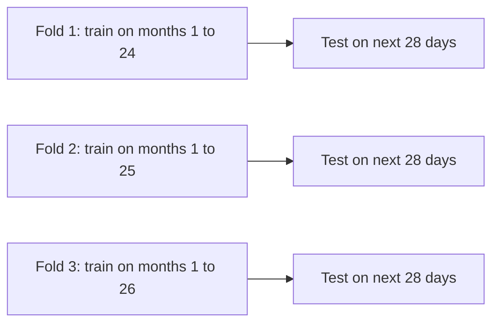
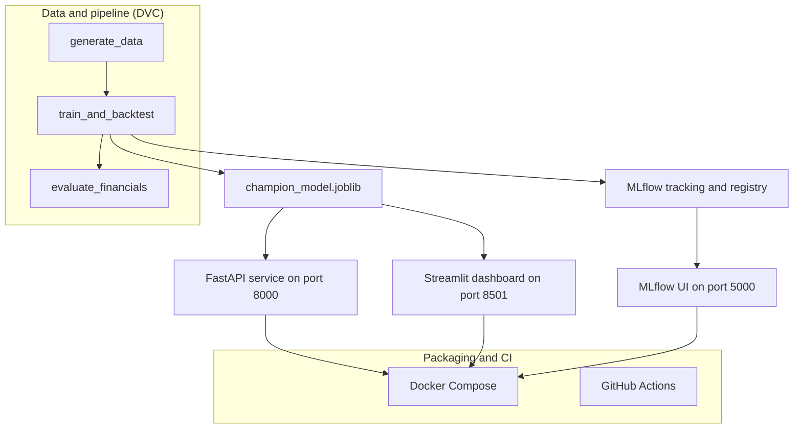
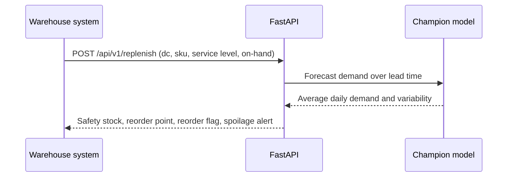

# FreshCast: Teaching a Forecast That Spoiled Salmon Costs More Than Spoiled Rice

*A demand-forecasting and inventory system for perishable food, where guessing too high and guessing too low are very different kinds of expensive.*

## TL;DR

- FreshCast forecasts daily demand for 10 perishable and non-perishable food products across 3 regional distribution centers (Boston, Atlanta, Chicago).
- It scores forecasts by **dollars lost** (spoiled food vs. empty shelves), not just by "how far off was I?".
- On backtests, the champion LightGBM model reaches **19.87% WAPE** and cuts total financial loss by **39.5%** versus a simple 7-day moving average.
- It ships as a complete system: reproducible pipeline (DVC), experiment tracking (MLflow), REST API (FastAPI), planner dashboard (Streamlit), Docker, and CI.

> **Honest note up front:** the sales data is *synthesized* by a generator in the repo (24,630 daily rows with weekly seasonality and promotions). The results show that the method works on realistic patterns. They are not measurements from a real distributor.

## The problem

Picture a warehouse that supplies restaurants. Every morning, chefs need salmon, chicken, lettuce and cream. The warehouse has to decide how much to buy days in advance.

Guess too high, and the salmon (shelf life: **4 days**) goes in the bin. Guess too low, and a restaurant can't cook its Friday-night special. That customer remembers, and contracts can carry penalties for it.

Standard forecasting tools treat both mistakes as equal: "you were off by 10 cases". But 10 cases of salmon thrown away and 10 cases of cooking oil you were short on are not the same problem. Oil lasts 240 days. Salmon lasts 4.

Restaurant demand also has its own rhythm:

- Kitchens restock heavily on **Mondays**, after the weekend has emptied the shelves.
- They place big buffer orders on **Thursdays and Fridays** for weekend dining.
- Promotions and supplier discounts cause sudden jumps in orders.

A forecast that ignores these habits, and the cost of being wrong, isn't much use to a planner.

## The idea

Think of a good restaurant manager who orders produce. They don't just average last week's orders. They remember "Mondays are busy", they order cautiously for things that rot fast, and they order a bit extra for things that hurt to run out of.

FreshCast does the same, in three steps:

1. **Learn the weekly rhythm** from past sales (what sold 1, 7 and 28 days ago, plus calendar and promo information).
2. **Test honestly** by forecasting only periods the model has never seen, as it would face them in real life.
3. **Judge by money**: every mistake is converted into dollars, using each product's cost, price and shelf life.

The forecast then feeds a second question planners care about: *"given what I have in stock, when should I reorder, and how much safety buffer do I need?"*

## How it works


In plain English:

1. **Data in.** A generator produces daily sales for 3 distribution centers and 10 products, over 820+ days.
2. **Clues out.** For each day, the system builds clues the model can use: day of week, holidays coming up, how much sold on the same day last week, the recent average, and whether a discount is running.
3. **Compete.** Four models compete: two simple baselines, LightGBM and XGBoost. LightGBM wins by a small margin.
4. **Forecast with a range.** For any product and location, the API and dashboard give a day-by-day forecast plus a low and high bound (the 10th and 90th percentiles).
5. **Reorder advice.** From the forecast, FreshCast computes a **safety stock** (a cushion for surprises) and a **reorder point** (the stock level at which you should order again). It also flags perishable items.

> **For the curious:** *Lag features* are just "what sold k days ago". FreshCast uses k = 1, 2, 3, 7, 14, 21 and 28. It adds rolling averages and volatility over 7, 14 and 28 days, plus ratios such as short-term versus long-term trend. All of them are *shifted* so that a prediction for day *t* only uses data up to day *t-1*.

### Being honest about the future

The most common mistake in forecasting projects is accidentally letting the model peek at the future. Randomly shuffled cross-validation does exactly that. FreshCast uses **expanding-window walk-forward validation** instead:



Each fold trains on the past and tests on the 28 days that follow. The training window grows each round, and feature pipelines are fitted only on that fold's training data.

### The cost of being wrong

Each forecast error is converted into dollars:

- **Over-forecast** means spoilage: excess units × unit cost × the product's spoilage factor.
- **Under-forecast** means stockout: missed units × profit margin (price minus cost) × a stockout penalty multiplier.

$$\mathcal{L}_{\text{total}} = \sum_i \max(\hat{y}_i - y_i, 0)\cdot c_i \cdot s_i \;+\; \sum_i \max(y_i - \hat{y}_i, 0)\cdot (p_i - c_i)\cdot m_i$$

Here $\hat{y}$ is the forecast, $y$ the actual demand, $c$ unit cost, $p$ unit price, $s$ spoilage factor and $m$ penalty multiplier.

The configured catalog shows why this matters:

| Product | Shelf life | Spoilage factor | Stockout multiplier |
| :--- | :---: | :---: | :---: |
| Atlantic Salmon Fillets (10 lb) | 4 days | 1.00 | 1.60x |
| Choice Angus Beef Sirloin (10 lb) | 6 days | 1.00 | 1.50x |
| Hass Avocados (48 ct) | 5 days | 0.90 | 1.40x |
| Heavy Whipping Cream (12x1 qt) | 14 days | 0.80 | 1.25x |
| Sharp White Cheddar (10 lb) | 28 days | 0.50 | 1.20x |
| Crispy Thin French Fries (6x5 lb) | 180 days | 0.10 | 1.20x |
| Canola Frying Oil (35 lb) | 240 days | 0.05 | 1.20x |

The full catalog also includes chicken breast, romaine hearts and Roma tomatoes. All of this lives in `configs/default_config.yaml`.

## Under the hood

### Architecture



### Key design decisions and why

| Decision | Why |
| :--- | :--- |
| **One global model for all 30 DC-SKU series** | The series share patterns (weekly rhythm, promo response), so one model learns from all of them instead of 30 small models learning from little data each. |
| **L1 objective (`regression_l1`) for LightGBM** | Minimizing absolute error lines up directly with WAPE, the headline metric, and is less thrown off by extreme outliers. |
| **WAPE as the main accuracy metric** | It is total absolute error divided by total demand, so it is easy to explain and comparable across products with very different volumes. |
| **Financial loss as a second scoreboard** | A model can look good on statistics and still be expensive. Dollars expose that. |
| **DVC for the pipeline** | Data generation, training and evaluation are declared as stages in `dvc.yaml`, with hashes locked in `dvc.lock`, so results are reproducible. |
| **MLflow for tracking** | Every run logs parameters, metrics and artifacts, and the champion is registered as `FreshCast-Champion`. |
| **Separate baselines** | A naive "same as last week" forecast and a 7-day moving average keep the ML model honest. If it can't beat these, it isn't worth deploying. |

LightGBM is configured with `num_leaves=31`, `max_depth=6`, `learning_rate=0.05`, `subsample=0.85` and `feature_fraction=0.85`. XGBoost is the challenger, using `reg:absoluteerror`.

### Trade-offs

- **Synthetic data** makes the project fully reproducible and shareable, but it can't prove real-world accuracy.
- **Tree models over deep learning** are quick to train and easy to inspect through feature importance, but they don't forecast "natively" the way dedicated time-series models do. That is why I built lag features by hand.
- **A Prophet wrapper** exists in `statistical.py`, and Prophet hyperparameters are in `configs/model_params.yaml`. The benchmark results cover the four models above only.

### Safety stock and reorder point

The dashboard computes the classic inventory formulas:

$$\text{SS} = z_{\alpha}\cdot\sigma_d\cdot\sqrt{L}, \qquad \text{ROP} = \mu_{LT} + \text{SS}$$

where $z_\alpha$ is set by the desired service level (for example 0.95), $\sigma_d$ is demand variability, $L$ is the supplier lead time and $\mu_{LT}$ is expected demand during that lead time.



> **For the curious:** A *safety stock* is the extra inventory you hold because demand is uncertain. A higher service level (95% vs. 90%) means a bigger cushion. For fast-spoiling items that cushion costs more, which is why the system also raises a spoilage-risk alert (the dashboard warns for shelf lives of 5 days or less).

### Tech stack

| Layer | Tools |
| :--- | :--- |
| Language | Python 3.11 |
| Models | LightGBM (champion), XGBoost (challenger), baselines, Prophet wrapper |
| Data and reproducibility | DVC |
| Experiment tracking | MLflow (SQLite backend in `mlruns.db`) |
| API | FastAPI with Pydantic schemas |
| Dashboard | Streamlit |
| Packaging | Docker multi-stage build, Docker Compose |
| Quality | pytest (14 tests), Black, Ruff |
| CI | GitHub Actions |

## Results and what I learned

Results come from **3 walk-forward folds** of 28 days each, across 30 DC-SKU series.

| Model | WAPE | MAE (cases) | RMSE (cases) | Total financial loss |
| :--- | :---: | :---: | :---: | :---: |
| LightGBM (champion) | **19.87%** | 56.93 | 84.26 | \$1,047,822 |
| XGBoost | 20.02% | 57.36 | 85.11 | \$1,054,323 |
| Naive seasonal (t-7) | 28.31% | 81.11 | 118.66 | \$1,469,233 |
| 7-day moving average | 33.14% | 94.98 | 129.06 | \$1,733,289 |

LightGBM's loss is split into \$556,543 of spoilage and \$491,278 of stockout penalties. That is a saving of **\$685,466 (39.5%)** compared with the 7-day moving average. It is also about \$421,000 less than the naive seasonal forecast.

Loss per case varies a lot by category, which is the whole point of the project:

| Category | WAPE | Loss per case |
| :--- | :---: | :---: |
| Seafood | 21.38% | \$16.15 |
| Meat and Poultry | 18.82% | \$7.93 |
| Dairy | 19.10% | \$3.85 |
| Produce | 20.77% | \$3.69 |
| Frozen | 18.14% | \$1.63 |
| Dry and Pantry | 17.98% | \$1.54 |

What I took away:

- **Accuracy and cost don't line up.** Seafood isn't the least accurate category by much, but each missed case costs about 10 times more than for pantry goods.
- **Seasonal naive is a tough baseline.** The gap between it and LightGBM is real but not enormous, a good reminder to always check.
- **Leakage prevention deserves tests.** `tests/test_features.py` checks that features don't peek at the future.
- **The boring parts matter.** DVC, MLflow and CI made the project far easier to rerun and trust.

## Try it yourself

You need Python 3.11, [`uv`](https://github.com/astral-sh/uv) (recommended) or `pip`, and optionally Docker.

```bash
git clone https://github.com/AbQaadir/FreshCast.git
cd FreshCast

make setup

# Run the DVC pipeline end-to-end
make dvc-repro

# Run the 14 tests, then check linting and formatting
make test
make lint
```

Launch the services locally, or all together with Docker:

```bash
# Option A: Local Python
make dashboard    # Streamlit UI on :8501
make api          # FastAPI service on :8000
make mlflow-ui    # MLflow server on :5000

# Option B: Docker Compose (all services in one command)
make docker-up
```

Then open the dashboard at http://localhost:8501, the API docs at http://localhost:8000/docs and MLflow at http://localhost:5000. Other handy commands: `make dvc-status`, `make docker-build`, `make docker-down`, and `docker-compose ps`.

Try the API:

```bash
curl -X GET "http://localhost:8000/health"

curl -X POST "http://localhost:8000/api/v1/forecast" \
  -H "Content-Type: application/json" \
  -d '{
    "dc_id": "DC_BOS",
    "sku_id": "SKU_BEEF_SIRLOIN",
    "horizon_days": 14,
    "discount_pct": 0.15
  }'

curl -X POST "http://localhost:8000/api/v1/replenish" \
  -H "Content-Type: application/json" \
  -d '{
    "dc_id": "DC_BOS",
    "sku_id": "SKU_BEEF_SIRLOIN",
    "service_level": 0.95,
    "current_on_hand_inventory": 300
  }'
```

The forecast response includes `total_projected_demand`, `average_daily_demand` and a list of `daily_forecasts`, each with `forecasted_demand`, `lower_bound_p10` and `upper_bound_p90`. The replenish response includes `safety_stock`, `reorder_point`, `reorder_recommended` and `spoilage_risk_alert`.

The dashboard offers 7, 14 and 28-day horizons with 90% prediction intervals and a what-if promo slider (0% to 30% discount). It also has benchmark and P&L tabs.

With Docker Compose, the three services are `freshcast-dashboard` (8501), `freshcast-api` (8000) and `freshcast-mlflow` (5000).

Every push or pull request to `main` triggers CI, which runs Black and Ruff, the 14 tests, a DVC dry run (`dvc repro --dry`) and a Docker build.

## What's next and limitations

- **Real data.** The biggest limitation is that the data is synthetic. Next I'd like to validate on real or public distributor data.
- **Uncertainty.** The prediction intervals are useful, but a dedicated quantile approach would make them more rigorous.
- **Smarter ordering.** Reorder logic currently uses classic safety-stock formulas. It could be linked more directly to the dollar-loss function.
- **Wider benchmarks.** The Prophet wrapper could be added to the benchmark table.

## Links

- Repository: https://github.com/AbQaadir/FreshCast
- License: Apache 2.0


## Real-world data mode (FreshRetailNet-50K)

This repository originally ships with a **synthetic-data** pipeline. To run an alternate mode on real observed fresh-retail sales, use the FreshRetailNet-50K dataset published by Dingdong Inc.:

- Dataset: https://huggingface.co/datasets/Dingdong-Inc/FreshRetailNet-50K
- Paper: https://arxiv.org/abs/2505.16319
- License: Creative Commons Attribution 4.0 International (CC BY 4.0). Retain attribution when redistributing derived work.
- Source data includes daily normalized sales, store/product identifiers, discount, holiday/activity indicators, stockout annotations, and weather variables.

### Setup and run (real data)

Python 3.11 is supported by the original project. In a terminal from the repository root:

```bash
python -m venv .venv
# Windows PowerShell: .venv\Scripts\Activate.ps1
# macOS/Linux: source .venv/bin/activate
python -m pip install --upgrade pip
pip install -e .
python scripts/prepare_real_data.py
python scripts/train_real.py
streamlit run app/streamlit_app.py
# In a second terminal, after activating the same environment:
uvicorn freshcast.api.app:app --host 127.0.0.1 --port 8000
```

The first preparation step downloads the public dataset through Hugging Face's `datasets` library and selects a compact panel of 3 stores x 10 products with complete time series. The downloaded raw dataset is not bundled in this source ZIP; this keeps the project archive small and avoids redistributing the full third-party dataset. An internet connection is required for the first download. The data source is documented in `data/raw/real_data_metadata.txt` after preparation.

### Important interpretation and limitations

1. FreshRetailNet-50K provides about 90 days per selected series. The real-data training script therefore uses **three chronological 7-day backtest folds** and a separate 14-day holdout, not the synthetic project's three 28-day folds. Metrics from the two modes are not directly comparable.
2. Its `sale_amount` is a globally normalized sales measure, not literal foodservice cases. FreshCast uses it as the forecasting target; do not describe outputs as physical cases.
3. The public data does not provide actual product-level supplier costs, selling prices, shelf lives, or lead times. The adapter marks these as **illustrative assumptions** for demonstrating the inventory dashboard. The resulting dollar-loss estimates are not actual business savings. Replace those assumptions with verified business data before making financial claims.
4. Sales can be censored during stockouts. This starter integration forecasts observed normalized sales and does not yet reconstruct latent demand using the hourly stock-status arrays.
5. No accuracy target is guaranteed. Re-run the provided chronological backtest and report the measured metrics from your own run.

If you want the original synthetic demo instead, keep using `make generate-data` and `make train`. For the real-world data path, use `make prepare-real-data` and `make train-real`.
